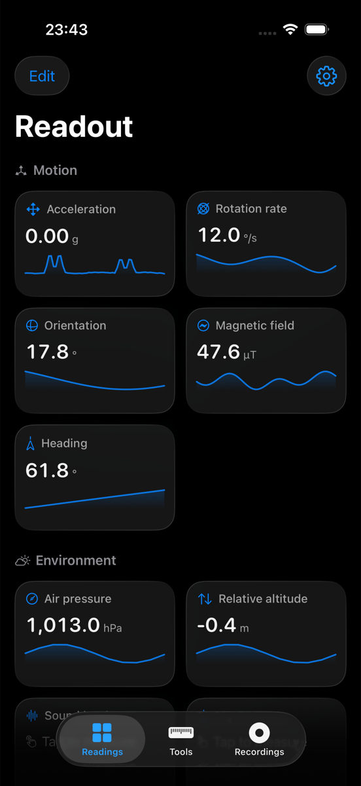
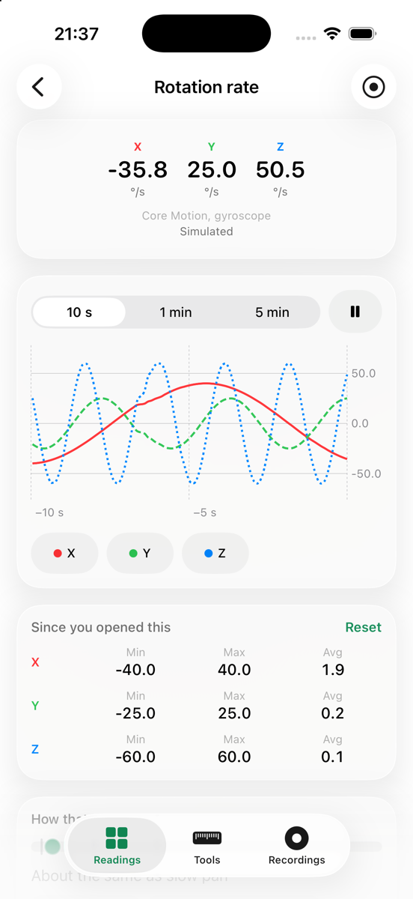
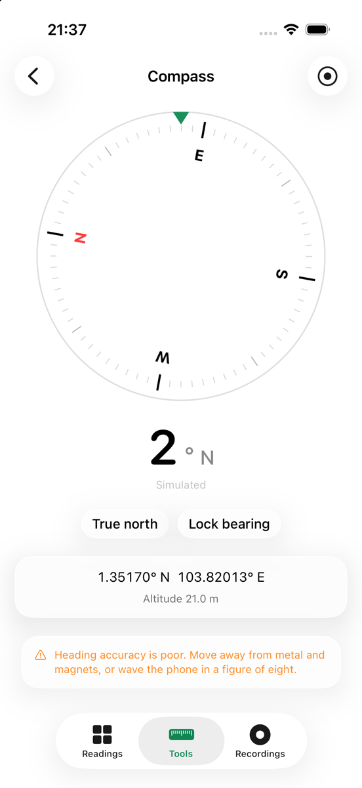
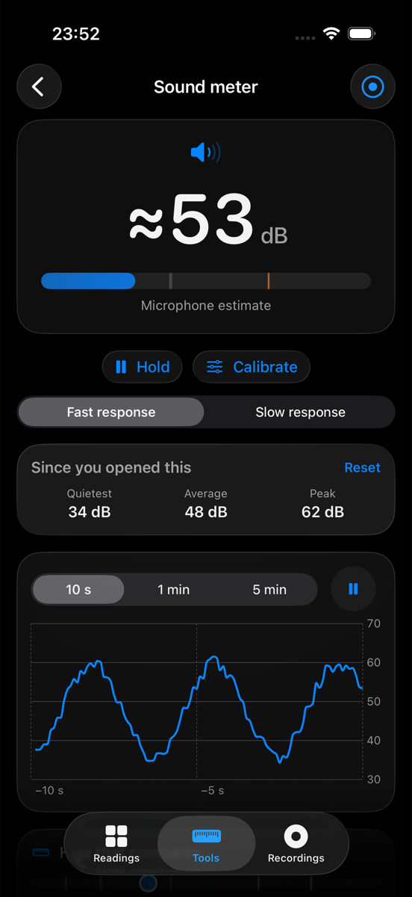

# Readout

[](https://github.com/leeyenkai/Readout/actions/workflows/ci.yml)
[](https://www.apple.com/ios/)
[](https://swift.org)
[](LICENSE)

A free, lightweight iPhone app that turns the phone's built-in sensors into clear, live
readings — and explains what each one actually measures.

Readout shows 19 readings across motion, environment, location and device activity, each with a
live chart, min/max/average, a plain-English explainer and a scale of everyday comparisons
("60 dB is a conversation; 85 dB is heavy traffic"). It adds four instruments: a spirit level,
a compass, a sound meter and a light meter.

It records too: pick the readings you want, start a session at the top of a journey and watch
it as it runs, then keep it, chart it, see the route it took and export it as CSV. Seven themes
and an interface size make it yours.

It is a hobby project. No ads, no in-app purchases, no accounts, and nothing it measures ever
leaves the phone. Readout makes no network request of its own; the single optional feature that
causes one — showing a recorded route on Apple Maps rather than plotting it offline — is off
until you turn it on, and Settings says which state you are in.

| | | | |
| --- | --- | --- | --- |
|  |  |  |  |
| Readings | Detail, chart and stats | Compass | Sound meter |

<sub>From the Simulator, where every number comes from a synthetic source — see
[Build and run](#build-and-run).</sub>

## Status

**v0.5.0 — logging a journey, and making it yours.** Every reading, every instrument, recording
and CSV export, the app icon, a calibration you can carry out against a reference meter — and
now a running session you can watch, the route a session logged, a session limit long enough
for a real journey, seven themes and an interface size. It is ready to hand to somebody: clone
it, set your own signing team, and it runs on your iPhone. There is no plan to put it on the
App Store.

A recording that includes your position carries on when you lock the phone or switch apps, so
a journey survives going in a pocket; iOS shows the blue location indicator while it does. A
session without a location reading cannot — there is no mechanism for it — and the app says
which applies before you start. The microphone and the camera never run in the background at
all. None of this is verified on a physical iPhone yet.

**Nothing has been verified on physical hardware yet.** Everything here was built and run in
the Simulator, where the numbers come from a synthetic source. What is left before 1.0 is the
work a build machine cannot do — the on-device checklist is
[`docs/RELEASE.md`](docs/RELEASE.md) §3.

See [`CHANGELOG.md`](CHANGELOG.md) for what has shipped and [`docs/SPEC.md`](docs/SPEC.md) §12
for the milestones.

## Requirements

- iOS 26.0 or later, iPhone only, portrait
- Xcode 26 or later — developed on Xcode 27, and CI builds and tests it on 26.6
- Swift 6 language mode; nothing here needs the iOS 27 SDK
- No third-party dependencies

## Build and run

```bash
git clone https://github.com/leeyenkai/Readout.git
cd Readout
open Readout.xcodeproj
```

Or from the command line:

```bash
xcodebuild -project Readout.xcodeproj -scheme Readout -destination 'generic/platform=iOS Simulator' build
```

Run the tests with:

```bash
xcodebuild -project Readout.xcodeproj -scheme Readout -destination 'platform=iOS Simulator,name=Readout iPhone' test
```

The Simulator has no sensors, so Readout takes every reading from a synthetic source there:
the interface is complete and demoable, every value says "Simulated", and none of it is real.

### On your own iPhone

Signing is deliberately unset, so you sign with your own team: open `Readout.xcodeproj`, then
target *Readout* → Signing & Capabilities → Team. A free Apple ID works — builds signed with
one stop running after seven days. If Xcode objects to the bundle identifier, change the
`com.leeyenkai` prefix to your own. [`docs/RELEASE.md`](docs/RELEASE.md) §2 has the whole
sequence, including what to say about the estimates when you pass it on.

## What it reads

| Group | Readings |
| --- | --- |
| **Motion** | Acceleration, rotation rate, orientation, magnetic field, heading |
| **Environment** | Air pressure, relative altitude, sound level, light |
| **Location** | Coordinates, GPS altitude, speed, course, accuracy |
| **Device & activity** | Steps/distance/floors, cadence and pace, proximity, battery, thermal state |

Two things iOS does not expose, and Readout therefore does not pretend to have: **ambient light**
(measured here through the camera, so it is an estimate) and **air temperature** (not available at
all — "Phone heat" is the device's own thermal state, not the room's).

Sound and light carry a "≈" for the same reason. If you own a sound level meter or a lux meter,
**Calibrate** in either tool takes its reading and works out the correction for your phone; it
stays on the device and nothing else changes.

## Privacy

Everything is measured and stored on the phone. The app makes no network request of its own and contains
no analytics or crash-reporting SDKs, so there is nothing for a privacy label to declare — the
privacy manifest in the bundle says exactly that.
Microphone audio and camera frames are read in memory to derive a level and are never saved.

Permissions are requested only when a reading needs one: Motion & Fitness (pressure, altitude,
steps), Location While Using (location group, true north), Microphone (sound), Camera (light).

## Repository layout

| Path | Contents |
| --- | --- |
| [`docs/SPEC.md`](docs/SPEC.md) | Specification and requirement IDs — the source of truth for scope |
| [`AGENTS.md`](AGENTS.md) | Working agreement: architecture rules, conventions, constraints |
| [`CONTRIBUTING.md`](CONTRIBUTING.md) | How to propose and make a change |
| [`CLAUDE.md`](CLAUDE.md) | Claude Code pointer to `AGENTS.md` |
| [`CHANGELOG.md`](CHANGELOG.md) | Release history |
| [`docs/RELEASE.md`](docs/RELEASE.md) | How to share it, how to run it on your own iPhone, and the on-device checklist that still gates v1.0 |
| `docs/screenshots/` | Simulator captures used in this README |
| `Readout/` | App source: `App/`, `Model/`, `Sensors/`, `Features/`, `Support/` |
| `ReadoutTests/` | Unit tests for the pure logic (units, dB/lux maths, statistics) |

## Contributing

[`CONTRIBUTING.md`](CONTRIBUTING.md) is the short version; [`AGENTS.md`](AGENTS.md) is the full
working agreement, covering the architecture rules, the privacy constraints and the requirement
that `CHANGELOG.md` and `docs/SPEC.md` move with the code.

## Licence

[MIT](LICENSE).
