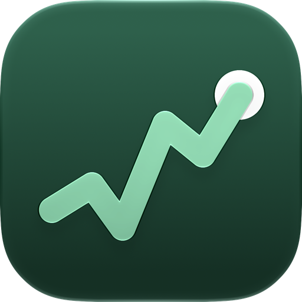
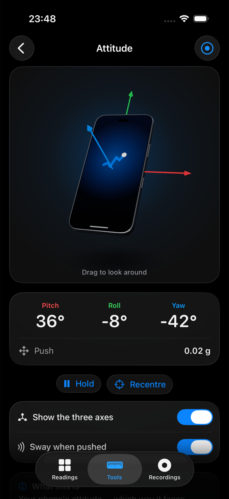

<p align="center">
  
</p>

<h1 align="center">Readout</h1>

<p align="center">
  Your iPhone's sensors, as clear live readings — and what each one actually measures.
</p>

<p align="center">
  <a href="https://github.com/leeyenkai/Readout/actions/workflows/ci.yml"></a>
  
  
  
  <a href="LICENSE"></a>
</p>

<table align="center">
  <tr>
    <td align="center"><br><sub>Readings</sub></td>
    <td align="center"><br><sub>Attitude, in 3D</sub></td>
    <td align="center"><br><sub>Chart and stats</sub></td>
    <td align="center"><br><sub>Compass</sub></td>
    <td align="center"><br><sub>Sound meter</sub></td>
  </tr>
</table>

<p align="center"><sub>Simulator captures: every number in them comes from a synthetic source.</sub></p>

## Features

- **19 live readings** across motion, environment, location and the device itself — each with
  a chart, min/max/average, a plain-English explainer and everyday comparisons
  ("60 dB is a conversation; 85 dB is heavy traffic").
- **Five instruments** — Attitude (your phone in 3D, turning as it does), a spirit level, a
  compass, a sound meter and a light meter.
- **Recording** — log any readings at 1, 10 or 50 Hz, watch them as they run, see the route a
  journey took, and export CSV. A recording that logs your position carries on in your pocket.
- **Calibration** against a reference sound or lux meter, if you own one.
- **True black by default**, seven themes and an interface size; every animation respects
  Reduce Motion.

<details>
<summary><b>Everything it reads</b></summary>

| Group | Readings |
| --- | --- |
| Motion | Acceleration, rotation rate, orientation, magnetic field, heading |
| Environment | Air pressure, relative altitude, sound level, light |
| Location | Coordinates, GPS altitude, speed, course, accuracy |
| Device & activity | Steps/distance/floors, cadence and pace, proximity, battery, thermal state |

iOS exposes neither the ambient light sensor nor air temperature. Light is estimated from the
camera's exposure, so it carries a "≈"; "Phone heat" is the device's own thermal state, not the
room's.

</details>

## Privacy

No ads, no accounts, no analytics. Everything is measured and stored on the phone, and Readout
makes no network request of its own — the one optional exception, showing a recorded route on
Apple Maps, is off until you turn it on. Microphone audio and camera frames are read in memory
for a level and never saved. Each permission is asked for only when a reading needs it.

## Getting started

You need Xcode 26 or later, and an iPhone on iOS 26 or the Simulator. There are no
dependencies to install.

```bash
git clone https://github.com/leeyenkai/Readout.git
open Readout/Readout.xcodeproj
```

- **Simulator** — runs as it is. There are no sensors there, so every reading comes from a
  synthetic source and says "Simulated".
- **Your iPhone** — signing is deliberately unset: choose your team under *Signing &
  Capabilities*. A free Apple ID works for seven days at a time. The full sequence is in
  [`docs/RELEASE.md`](docs/RELEASE.md) §2.

Run the tests from the command line, with any simulator from
`xcrun simctl list devices available`:

```bash
xcodebuild -project Readout.xcodeproj -scheme Readout \
  -destination 'platform=iOS Simulator,name=iPhone 17' test
```

## Status

**v0.6.0.** Everything above is built and tested in the Simulator, and CI builds and tests
every push. It has not yet been verified on a physical iPhone — the on-device checklist that
gates 1.0 is in [`docs/RELEASE.md`](docs/RELEASE.md) §3. There is no plan to put it on the
App Store; it is made to be built and shared.

## Documentation

- [**Changelog**](CHANGELOG.md) — what each release changed
- [**Specification**](docs/SPEC.md) — scope and requirement IDs, the source of truth
- [**Running and sharing it**](docs/RELEASE.md) — signing it for your own iPhone, passing it
  on, and the on-device checklist that gates 1.0
- [**Contributing**](CONTRIBUTING.md) — how to propose and make a change
- [**Working agreement**](AGENTS.md) — architecture, conventions and privacy rules

## Licence

Free and open source under the [MIT licence](LICENSE) — use it, change it and share it.
